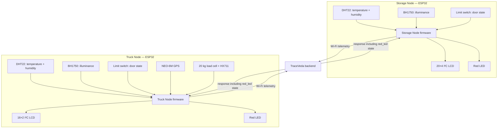

# System Architecture

## Purpose

The TraceVeda hardware layer collects environmental and handling telemetry at two stages: stationary storage and transportation.

## System overview

## Storage Node

The Storage Node monitors:
- Temperature and relative humidity using DHT22.
- Ambient illuminance using BH1750.
- Door state using a limit switch.

It displays information on a 20×4 I²C LCD and controls a red LED using the backend response.

## Truck Node

The Truck Node monitors:
- Temperature and relative humidity using DHT22.
- Ambient illuminance using BH1750.
- Compartment-door state using a limit switch.
- GPS position using a NEO-6M receiver.
- Payload weight using a 20 kg load cell and HX711 amplifier.

It displays information on a 16×2 I²C LCD and controls a red LED using the backend response.

## Backend integration

Both nodes were integrated with the backend. Their final firmware sends telemetry to:

`POST /api/iot/readings`

The firmware also receives and processes backend responses. The red LED output is controlled using the `red_led` field described in the source comments and response-handling code.

The API base URL and device key are configuration values and are not documented here as live credentials.
