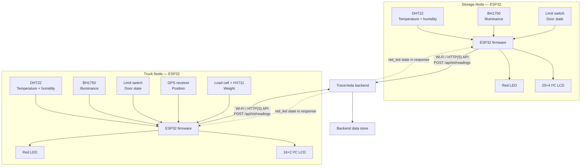

# Hardware System Architecture

## Purpose

The TraceVeda hardware layer gathers physical-condition and handling telemetry from two points in the herbal supply chain: a stationary storage environment and a moving transport vehicle.

## System-level view

The firmware comments describe HTTPS/API telemetry and device-key authentication. The actual base URL and credentials are intentionally omitted from this portfolio copy.

## Node responsibilities

### Storage Node

- Reads temperature and relative humidity from DHT22.
- Reads illuminance from BH1750 over I²C.
- Reads a digital limit switch as the storage-door state.
- Displays status/readings on a 20×4 I²C LCD.
- Drives a red LED using the state received from the backend.
- Queues telemetry and uses LittleFS for offline backlog handling.

### Truck Node

- Reads temperature and relative humidity from DHT22.
- Reads illuminance from BH1750 over I²C.
- Reads a compartment-door limit switch.
- Receives GPS data over UART2 and parses NMEA data using TinyGPSPlus.
- Reads a load cell through an HX711 amplifier.
- Displays rotating status/readout screens on a 16×2 I²C LCD.
- Queues telemetry and uses LittleFS for offline backlog handling.
- Drives a red LED using backend response state.

## Boundary of the hardware contribution

The ESP32 nodes acquire, package, queue, and transmit device readings. Backend persistence, threshold policy, batch workflows, dashboards, and the rest of the supply-chain platform belong to the wider TraceVeda software system.
