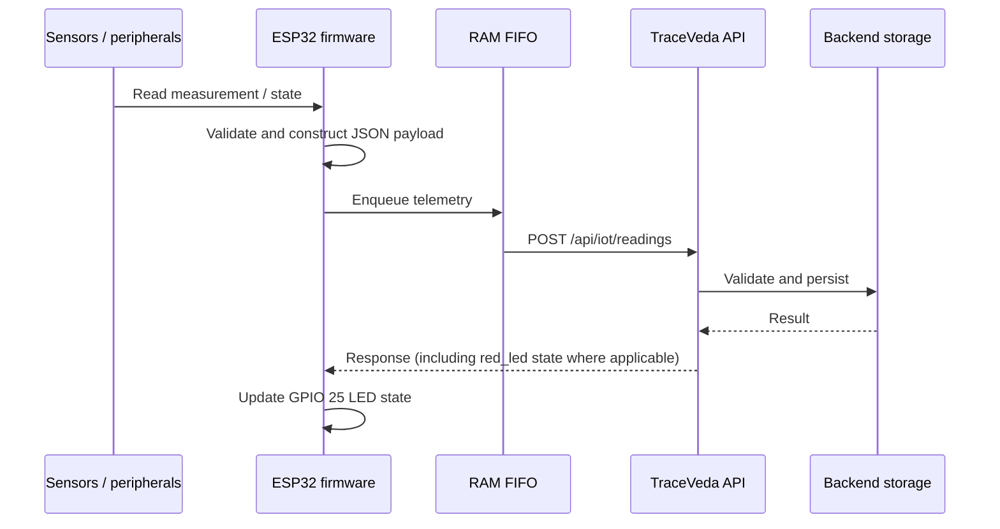
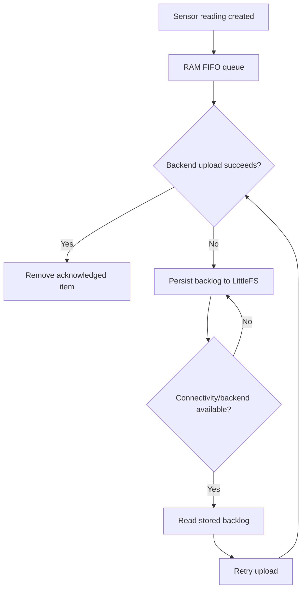

# Telemetry Data Flow

## Online path

## Offline/retry path

The exact retry/backoff and queue-capacity behaviour is defined in the firmware implementation. Do not infer guaranteed delivery under every power-loss or flash-failure scenario; test those cases explicitly before making a reliability claim.

## Sensor categories

| Category | Storage Node | Truck Node |
|---|---:|---:|
| Temperature | Yes | Yes |
| Relative humidity | Yes | Yes |
| Illuminance | Yes | Yes |
| Door state | Yes | Yes |
| GPS position | No | Yes |
| Payload weight | No | Yes |

## Backend interface

Both integrated sketches reference:

`POST /api/iot/readings`

The API base URL and device key are configuration values and are intentionally not included in this public documentation. Use the backend team's current API contract as the source of truth for payload fields and authentication.
